<p align="center">
  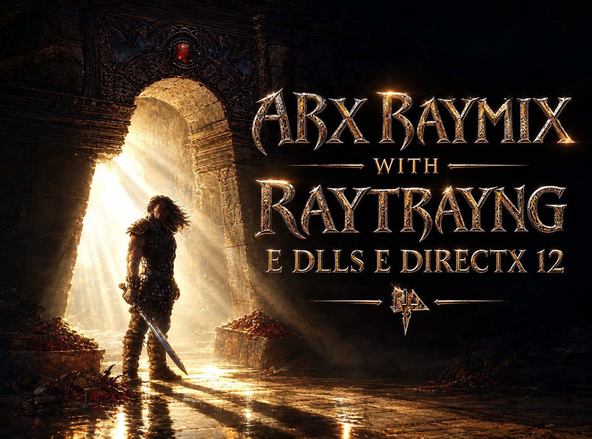
</p>

<p align="center">
  
  
  
  
  
  
</p>

<p align="center">
  <a href="README.md">English</a> · <a href="docs/README.pt-BR.md">Português (Brasil)</a>
</p>

**Arx Raymix** is a Windows remaster of *Arx Fatalis* (Arkane Studios, 2002), built on the [Arx Libertatis](https://arx-libertatis.org/) engine. It adds a **Direct3D 12** renderer with optional **DXR ray tracing**, plus NVIDIA **DLSS** (Super Resolution, Ray Reconstruction), **DLSS Frame Generation** and **Reflex**. Direct3D 9 stays as a fallback.

It is the same game. You need your own copy of Arx Fatalis (Steam or GOG); no game data is included or redistributed.

## Screenshots

Same place, ray tracing off and on (F7 switches it in game). RTX 4050 Laptop, High preset, DLSS Quality.

| Ray tracing off | Ray tracing on |
|---|---|
| 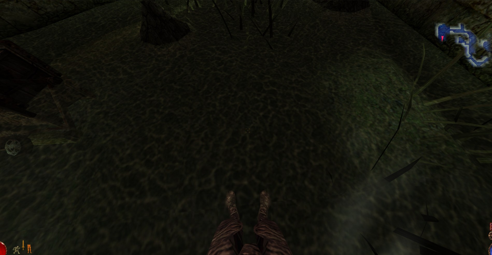 | 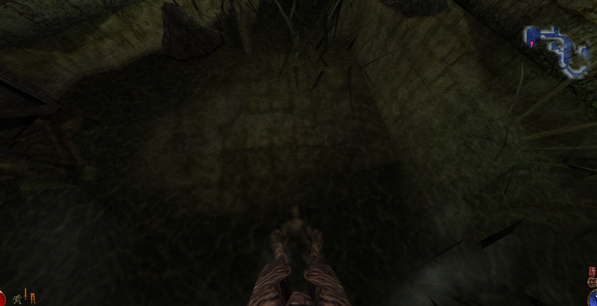 |
| 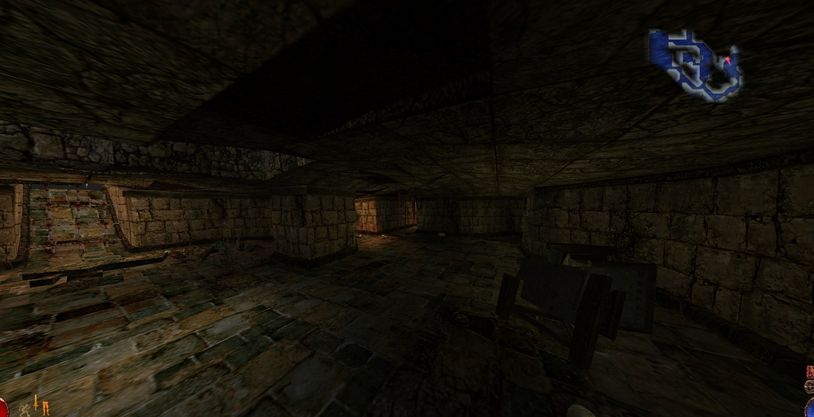 | 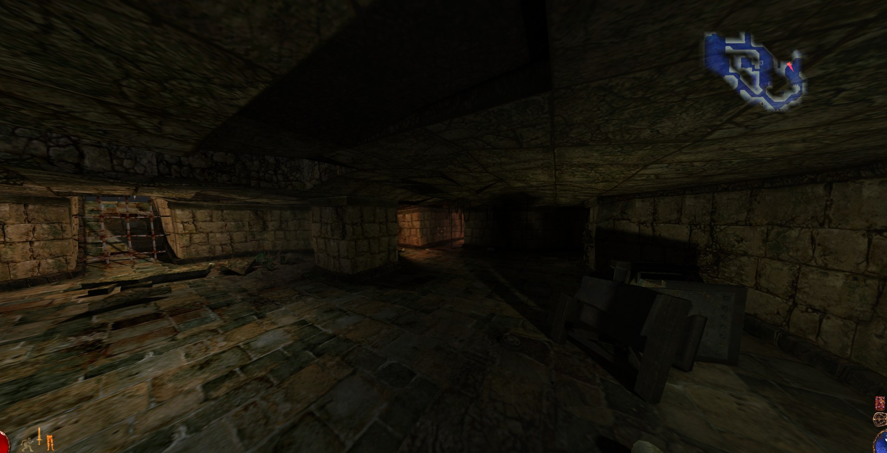 |
| 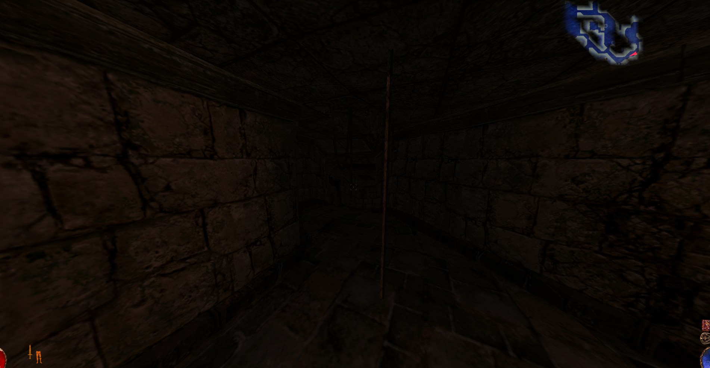 | 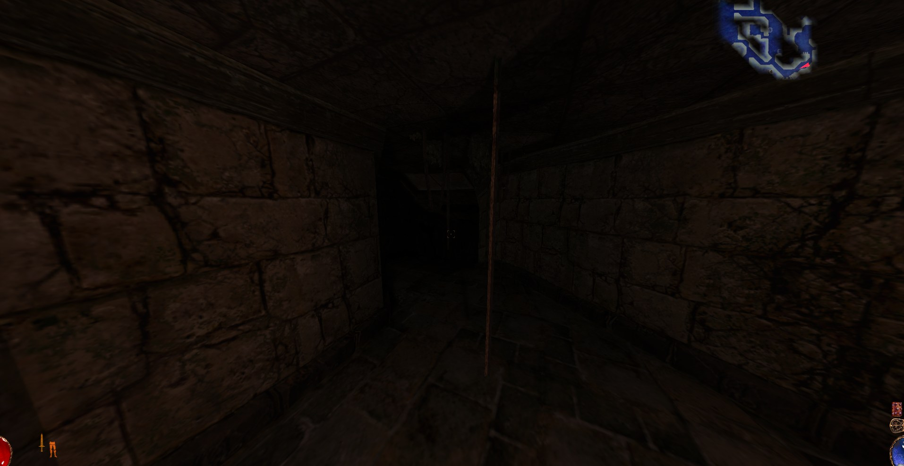 |

<p align="center">
  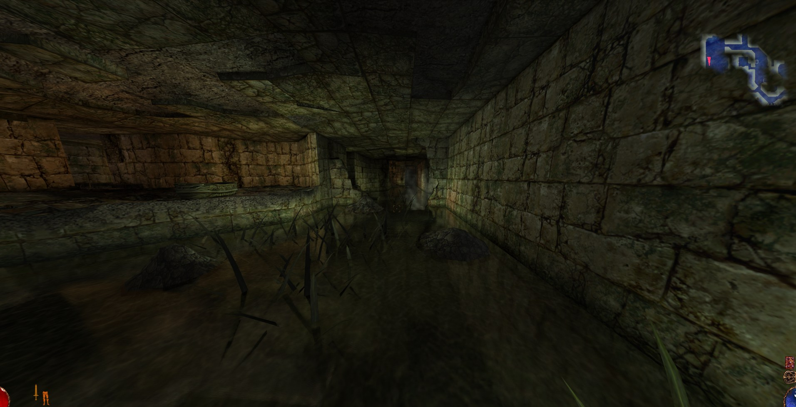
</p>

| Options → Ray tracing | Options → Video (DirectX 12, DLSS, Frame Generation) | Options |
|---|---|---|
| 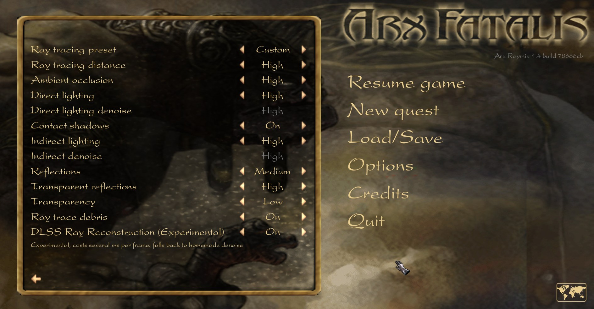 | 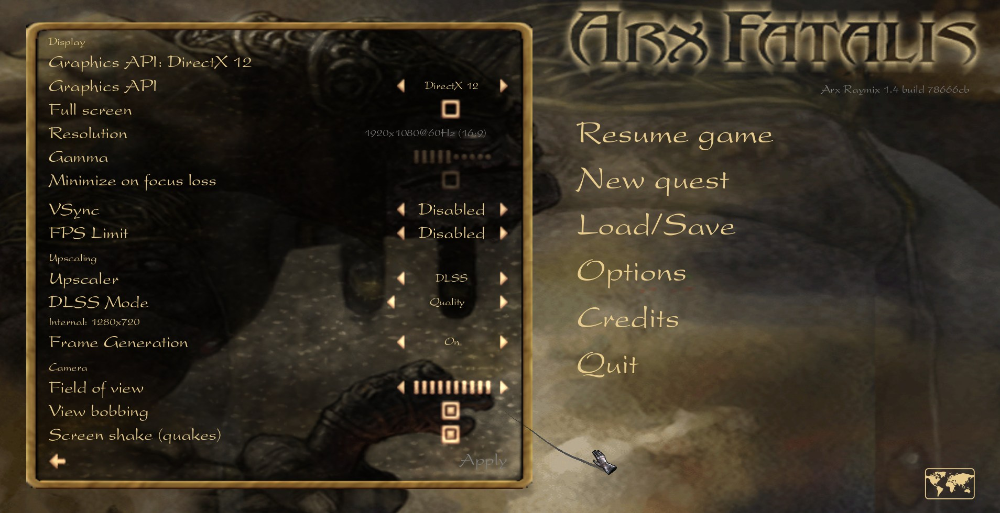 | 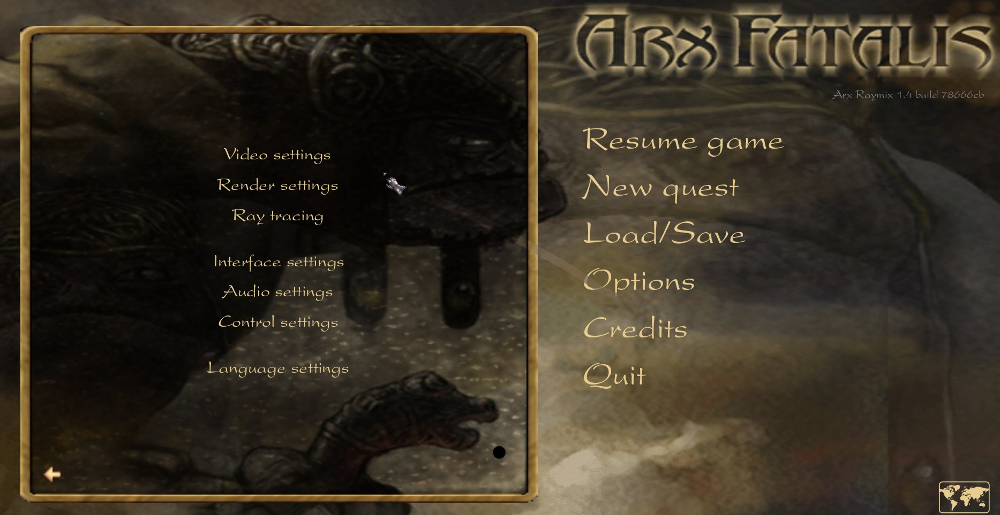 |

## Features

- **Direct3D 12 renderer**, the default. If D3D12 cannot start, the game falls back to Direct3D 9 for that launch.
- **Hybrid ray tracing (DXR)** on top of the raster image: ambient occlusion, shadows from the level's own lights (soft edges), one bounce of indirect light, water / metal reflections, and **volumetric fog** whose light shafts are cut by the level geometry. Each effect is Off / Low / Medium / High, with a **Ray tracing distance** setting. Switching ray tracing off leaves the complete raster renderer.
- **First-run preset.** On the first launch with a DXR GPU, the game picks Low, Medium or High from your video memory, and DLSS Quality where available.
- **DLSS Super Resolution** (DLAA, Quality, Balanced, Performance, Ultra Performance).
- **DLSS Frame Generation** (2×), with **Reflex** low latency switched on alongside it.
- **DLSS Ray Reconstruction**, experimental.
- **Render distance** slider that pushes the far plane out to the old maximum.
- **Brazilian Portuguese text** (menus and in-game text), optional. English is the default.
- **Performance overlay**: F11 shows FPS, the DLSS mode and GPU time per pass.
- Everything Arx Libertatis already does: widescreen, modern resolutions, bug fixes, and so on.

New in v1.4 (see the [release notes](docs/RELEASE-NOTES-1.4.md)):

- **Auto-update** through an `ArxRaymix.exe` launcher, plus an in-game "new version available" notice that can be turned off.
- **F7** switches ray tracing on and off instantly, for comparisons and screenshots. Your saved settings are not changed.
- **Options → Interface → Performance overlay**: Off, FPS, or FPS + GPU time.
- A **language prompt** on the first run (English or Português (Brasil)).


## Requirements

| | |
|---|---|
| OS | Windows 10 or 11, 64-bit |
| Game | Your own copy of **Arx Fatalis** from Steam or GOG |
| GPU (basic) | A GPU with a Direct3D 12 driver. Older GPUs use the Direct3D 9 fallback |
| Ray tracing | A GPU and driver with DirectX Raytracing (DXR) support |
| DLSS Super Resolution / Ray Reconstruction | An NVIDIA GeForce RTX GPU |
| DLSS Frame Generation | An NVIDIA GeForce RTX 40 series GPU or newer |
| Minimum / recommended GPU | <!-- TODO Gabriel: fill in tested GPUs and VRAM (development hardware: RTX 4050 Laptop) --> |

Nothing else is needed: no game patch, no other mod, no Arx Libertatis install. The Steam and GOG releases already contain the data the engine needs.

**Without an NVIDIA GPU or without DXR**, the game still runs on Direct3D 12 with the normal raster image. The Ray tracing page and the DLSS options are grayed out with the reason shown ("Requires DirectX 12 and a GPU with DXR", "Requires an NVIDIA GPU with DLSS"). On Direct3D 9 there is no ray tracing and no DLSS.

## Download

- **Nexus Mods** (main channel): [NEXUS_URL] <!-- TODO Gabriel: Nexus page URL -->
- **GitHub Releases**: <https://github.com/gabriel7silva/ArxRaymix/releases>

Two downloads, same files: the installer `ArxRaymix-v1.4-setup.exe` (recommended) and the zip `ArxRaymix-v1.4.zip`. Each has a `.sha256` file next to it on the GitHub release.

## Install

1. Install Arx Fatalis from Steam or GOG.
2. Run `ArxRaymix-vX.Y-setup.exe` (no administrator prompt; Start menu shortcuts and an uninstaller), **or** extract the zip to its own folder, for example `C:\Games\ArxRaymix`. Never inside the Arx Fatalis folder.
3. Start *Arx Raymix* from the Start menu, or run `ArxRaymix.exe` (or `arx.exe`).

Arx Raymix is **not digitally signed yet**, so Windows SmartScreen shows "Windows protected your PC" the first time: click **More info → Run anyway**. Signing is planned; until then you can check each download against the `.sha256` on the release page.

Step-by-step instructions for Steam and GOG, and what to do if the game is not found, are in [docs/INSTALL.md](docs/INSTALL.md).

## First run

- The first time you start (when `cfg.ini` has no language yet), a **Language / Idioma** screen lists the available text languages, English first. Pick one; you can change it later in **Options → Language settings**. Voices stay in English: the Portuguese voice files belong to Arkane and are not included.
- With a DXR GPU, a ray tracing preset is chosen for you from your video memory (Low under 5 GiB, High from 9 GiB, Medium in between), and DLSS Quality is turned on if your GPU supports it. Change either at any time.
- Your settings are saved to `cfg.ini` in your user folder (see [Troubleshooting](#troubleshooting)).

## Settings

| Where | What |
|---|---|
| Options → Video | Graphics API (DirectX 12 / DirectX 9, applies on next launch), resolution, **Upscaling** (DLSS mode), **Frame Generation** |
| Options → Render | **Render distance**, antialiasing (locked off while DLSS is on), texture filtering |
| Options → Ray tracing | **Preset** (Off / Low / Medium / High / Custom), per-effect sliders, **Ray tracing distance**, **DLSS Ray Reconstruction (Experimental)** |
| Options → Interface | **Performance overlay**: Off / FPS / FPS + GPU time (new in v1.4) |
| Options → Language settings | Text language (English, Português (Brasil), …) and audio language |

Ray tracing settings apply immediately. Changing the graphics API needs a restart; the Video page says so.

| Key | Action |
|---|---|
| F11 | Cycle the performance / debug overlay (first panel: FPS, DLSS line, GPU time) |
| F10 | Screenshot (`snapshot_<n>.bmp` in your user folder) |
| F7 | Ray tracing on / off for this session, without changing your settings (new in v1.4) |

The `cfg.ini` keys behind these settings are listed in [docs/CONFIGURATION.md](docs/CONFIGURATION.md).

## Updating

From v1.4, `ArxRaymix.exe` checks the latest GitHub Release when it starts. If there is a newer version it offers to update. On yes, it downloads the zip, checks its SHA-256, replaces only the mod's own files (the old ones go to `backup`, and `ArxRaymix.exe --rollback` restores them) and starts the game. Offline or on any error it just starts the game. It never touches `cfg.ini`, your saves or the Arx Fatalis folder. If you start `arx.exe` directly, the main menu shows a "new version available" notice instead; turn it off in Options → Interface → Check for updates. Details in [docs/INSTALL.md](docs/INSTALL.md#updating).

To update by hand: download the new zip and extract it over the old folder, or into a new folder. Settings and saves are not in the mod folder, so they carry over.

## Uninstall

Delete the Arx Raymix folder. That is all the mod installs; Arx Fatalis itself is not modified.

Your saves and `cfg.ini` stay in your user folder. Delete that folder too only if you want to remove them, and note that Arx Libertatis uses the same folder.

## Troubleshooting

**User folder.** Saves, `cfg.ini` and `arx.log` are in `%USERPROFILE%\Saved Games\Arx Libertatis` (or `Documents\My Games\Arx Libertatis` if that folder already exists). Run `arx.exe --list-dirs` to see the folders actually in use. This folder is shared with Arx Libertatis.

**`arx.log`** is rewritten on every launch. Attach it to any bug report, along with your GPU, driver version and the settings you used.

**The game data is not found.** Steam and GOG installs are found on their own. For any other location, point the game at the folder that holds `data.pak`:

```text
arx.exe --data-dir "C:\Program Files (x86)\Steam\steamapps\common\Arx Fatalis"
```

Put that in a shortcut's *Target* field to keep it. See [docs/INSTALL.md](docs/INSTALL.md#4-if-the-game-data-is-not-found) for other options.

**The game starts on DirectX 9** or ray tracing is grayed out: check the first lines of `arx.log` (`Using D3D12 renderer`, `RaytracingTier=…`) and update your GPU driver. `Arx Raymix - DirectX 9.bat` starts the D3D9 fallback for one session without changing your settings.

**DLSS options are grayed out**: the release zip includes the NVIDIA DLLs; the options need an NVIDIA RTX GPU (Frame Generation: RTX 40 or newer) and a current driver.

**Ray Reconstruction** is experimental. On some GPUs NVIDIA's feature cannot start; the setting then stays On but the built-in denoiser keeps running. It also costs noticeably more GPU time than DLSS alone.

More in [docs/INSTALL.md](docs/INSTALL.md#troubleshooting). Bug reports: [GitHub Issues](https://github.com/gabriel7silva/ArxRaymix/issues). <!-- TODO Gabriel: confirm Issues is the bug channel, or point to the Nexus Bugs tab. -->

## Building from source

Visual Studio 2022 and CMake 3.12+; all Windows dependencies are vendored in `libs/`.

```bash
git clone https://github.com/gabriel7silva/ArxRaymix.git
cmake -S . -B build -G "Visual Studio 17 2022" -A x64
cmake --build build --config RelWithDebInfo --target arx --parallel
```

DLSS needs `scripts/fetch-streamline.ps1` first. Full instructions, launch scripts, tests and packaging: [docs/BUILDING.md](docs/BUILDING.md).

| Developer docs | |
|---|---|
| [Building](docs/BUILDING.md) | Toolchain, build, run, CI, package |
| [Architecture](docs/ARCHITECTURE.md) | How the D3D9 / D3D12 backends and the DXR layer fit |
| [Configuration](docs/CONFIGURATION.md) | `cfg.ini` keys and directories |
| [Contributing](docs/CONTRIBUTING.md) | Where things live, tests, debugging |
| [Upstream](docs/UPSTREAM.md) | What differs from Arx Libertatis |
| [Launch scripts](scripts/README.md) | Script options and debug variables |
| [Ray tracing](arx/src/graphics/dxr/README.md) | DXR and Streamline internals |
| [Maintenance guide](docs/maintenance/README.md) | Working reference for code changes |

Portuguese developer docs: [docs/pt-BR/README.md](docs/pt-BR/README.md).

## Credits

- **Arkane Studios**: *Arx Fatalis* (2002). This mod runs their game; it does not include it.
- **[Arx Libertatis](https://arx-libertatis.org/) team and contributors**: the engine this is built on. See [`arx/AUTHORS`](arx/AUTHORS) and [`arx/CHANGELOG`](arx/CHANGELOG).
- **NVIDIA**: Streamline SDK, DLSS, DLSS Frame Generation and Reflex.
- **Microsoft**: DirectX Shader Compiler (`dxcompiler.dll`, `dxil.dll`).
- **Parricidium**: the volumetric fog follows the haze of [ArxCoop](https://github.com/Parricidium/ArxCoop) (GPLv3), adapted to traced shadows.
- Libraries from [ArxWindows](https://github.com/arx/ArxWindows): SDL2, OpenAL Soft, Boost, FreeType, GLM, zlib.
- **Arx Raymix**: Gabriel Silva ([gabriel7silva](https://github.com/gabriel7silva)). <!-- TODO Gabriel: confirm how you want to be credited -->

## License and copyright

- **Engine code** is GPLv3 ([LICENSE](LICENSE)): Copyright (C) 2011-2023 Arx Libertatis Team and Contributors, with Arx Raymix changes by Gabriel Silva, based on the Arx Fatalis GPLv3 source code, Copyright (C) 1999-2010 Arkane Studios SA, a ZeniMax Media company. Some files are under more permissive licenses; each file's header is authoritative. See also [`arx/COPYING`](arx/COPYING).
- **Arx Fatalis** and its game data are © Arkane Studios / ZeniMax Media / Bethesda Softworks. They are not included or redistributed.
- **NVIDIA DLSS, Streamline and Reflex** binaries are © NVIDIA Corporation and distributed under NVIDIA's own license terms, not the GPLv3.
- Third-party libraries keep their own licenses: see [THIRD-PARTY-NOTICES.md](THIRD-PARTY-NOTICES.md). The release zip carries every license text in its `licenses\` folder.

Arx Raymix is not affiliated with or endorsed by Arkane Studios, ZeniMax Media, Bethesda Softworks or NVIDIA.
