# Building Arx Raymix

For developers. Players do not need any of this: download the release zip instead (see [INSTALL.md](INSTALL.md)).

Portuguese: [pt-BR/README.md](pt-BR/README.md).

## Built on Arx Libertatis

This is a fork of [**Arx Libertatis**](https://arx-libertatis.org/), the open-source engine for Arx Fatalis, combined with the [ArxWindows](https://github.com/arx/ArxWindows) dependency tree so the whole thing builds from one clone.

| | |
|---|---|
| Upstream project | [arx/ArxLibertatis](https://github.com/arx/ArxLibertatis) |
| Base version | **Arx Libertatis 1.3-dev** |
| Base commit | `5b95e4c5ca9d583f1b11c085326979772645e0f3` (`git describe`: `1.2-2756-g5b95e4c5c`) |
| Windows dependencies | [arx/ArxWindows](https://github.com/arx/ArxWindows), vendored in `libs/` |

Upstream history is not carried in this repository. [`UPSTREAM.md`](UPSTREAM.md) lists files that differ from that commit.

Everything Arx Libertatis does still works. This adds rendering backends; it does not replace the game. Credit for the engine belongs to the Arx Libertatis team; see [`arx/AUTHORS`](../arx/AUTHORS).

## Where it stands

<p align="center">
  
</p>

- **Direct3D 12 is the default.** On Windows the window creates a D3D12 device. If that fails, it falls back to D3D9 for that launch.
- **Ray tracing on top of the raster.** With a DXR-capable GPU, the D3D12 backend adds ray traced ambient occlusion, shadows from the level's own lights, one bounce of indirect light, and water / metal reflections. Each DXR effect is **Off / Low / Medium / High** in Options → Ray tracing, plus a **Ray tracing distance** (Low / Medium / High / Ultra). Without DXR support the game runs the plain raster and says so in the log.
- **DLSS and Frame Generation.** Options → Video: Upscaling Off / DLSS (DLAA through Ultra Performance) and Frame Generation Off / On. They are independent of the RT preset. **DLSS Ray Reconstruction** is experimental: if NGX cannot create the feature the homemade denoiser keeps drawing.
- **Render distance.** Options → Render controls the far plane (`cfg.ini` `fog=`).
- **Direct3D 9 is a first-class fallback.** Same game, same HWND, separate backend under `arx/src/graphics/d3d9/`.
- **Video Options picks the API** for the next launch. The current session always shows which API is active.

The renderer is hybrid: the world is rastered and rays are traced on top of the finished image. Multi-bounce path tracing (the old Phase 6) is **archived**. Earlier experiments with RTX Remix were deleted and are not how the game is launched. Phases 1–4 (RTAO, DXR shadows, penumbra + one bounce, water / metal reflections) are done; Phase 5 is DLSS + Frame Generation, with Ray Reconstruction experimental. See [`arx/src/graphics/dxr/README.md`](../arx/src/graphics/dxr/README.md).

## Toolchain

| | |
|---|---|
| OS | Windows 10 or 11, x64 |
| Compiler | Visual Studio 2022 or newer with the C++ desktop workload |
| CMake | 3.12+ |
| Game data | Your own copy of Arx Fatalis (Steam or GOG), to run what you build |

All Windows dependencies (Boost, SDL2, GLM, FreeType, OpenAL Soft, zlib, the DirectX Shader Compiler, …) are in `libs/`, so there is nothing else to fetch for a raster + DXR build.

## Build

```bash
git clone https://github.com/gabriel7silva/ArxRaymix.git
```

```bash
cmake -S . -B build -G "Visual Studio 17 2022" -A x64
```

```bash
cmake --build build --config RelWithDebInfo --target arx --parallel
```

Windows builds compile both backends.

### DLSS and Frame Generation (optional)

The NVIDIA Streamline SDK binaries are not in the source tree. Fetch them once, then reconfigure and rebuild:

```powershell
powershell -ExecutionPolicy Bypass -File scripts/fetch-streamline.ps1
```

The script downloads Streamline 2.12.0 from NVIDIA's GitHub release, checks a pinned SHA-256 and the NVIDIA Authenticode signature, and lays it out under `arx/third_party/streamline/`. CMake then copies the DLLs next to `arx.exe`. Without it the build works, but DLSS and Frame Generation are unavailable.

## Run

```powershell
powershell -ExecutionPolicy Bypass -File scripts/run-d3d12.ps1
powershell -ExecutionPolicy Bypass -File scripts/run-d3d9.ps1
```

`run-dx12.ps1` and `run-dx9.ps1` are the same launchers under the DirectX names. The scripts find your Arx Fatalis install from the Steam and GOG registry entries. Pass `-DataDir '<path>'` to override. Other options (`-LoadLevel`, `-Config`, `-DxrDebug`, `-D3d12Debug`) and the `ARX_*` debug variables are in [`scripts/README.md`](../scripts/README.md).

The scripts are wrappers around:

```text
build\arx\RelWithDebInfo\arx.exe --user-dir runtime\user --data-dir "<path to Arx Fatalis>"
```

| Flag or variable | Meaning |
|---|---|
| `--data-dir <path>` | Your Arx Fatalis install, the directory holding `data.pak` |
| `--user-dir <path>` | Where saves, config and `arx.log` are written |
| `--loadlevel <n>` | Skip the menu and load a level directly |
| `--list-dirs` | Print the data directories actually in use, in priority order |
| `ARX_RENDERER` | `d3d12` / `dx12` / `DirectX 12` or `d3d9` / `dx9` / `DirectX 9`. Overrides `cfg.ini` for this process only |

Logs from script runs go to `runtime/user/arx.log`. Quit from the menu.

## Tests and CI

Unit tests live in `arx/tests/` (CppUnit). CppUnit is not vendored, so the Windows build leaves them off. [CI](../.github/workflows/ci.yml) runs two jobs on every pull request and every push to `main`:

- **linux-tests**: builds the engine without the Windows renderers and runs `arxtest`.
- **windows-build**: compiles the embedded HLSL (`scripts/check-shaders.py`), fetches Streamline, builds `arx` with MSVC and runs `scripts/package.ps1`. The zip is uploaded as a workflow artifact (14 days).

Locally on Linux:

```bash
cmake -S arx -B build-tests -G Ninja -DBUILD_TESTS=ON -DICON_TYPE=none
cmake --build build-tests --target arxtest
./build-tests/arxtest
```

## Package

```powershell
powershell -ExecutionPolicy Bypass -File scripts/package.ps1 -Version 1.4
```

Needs a RelWithDebInfo build; run `fetch-streamline.ps1` first or the package has no DLSS / Frame Generation (the script warns). The zip holds `arx.exe`, the DLLs CMake staged next to it, `data\` (from `arx/data/core`), `LICENSE`, `AUTHORS`, a generated `README.txt` and `Arx Raymix - DirectX 9.bat`. It never holds game data, PDBs (unless `-IncludePdb`), `data.dirs` or the imported PT-BR speech WAVs. The script prints the zip's SHA-256.

## Documentation

| English | Português (Brasil) |
|---|---|
| [Install (players)](INSTALL.md) | [Instalação (jogadores)](README.pt-BR.md) |
| [Docs index](README.md) | [pt-BR/README.md](pt-BR/README.md) |
| [Architecture](ARCHITECTURE.md) | [Arquitetura](pt-BR/ARCHITECTURE.md) |
| [Configuration](CONFIGURATION.md) | [Configuração](pt-BR/CONFIGURATION.md) |
| [Contributing](CONTRIBUTING.md) | [Contribuição](pt-BR/CONTRIBUTING.md) |
| [Upstream](UPSTREAM.md) | [Upstream](pt-BR/UPSTREAM.md) |
| [Launch scripts](../scripts/README.md) | (same scripts) |
| [Ray tracing](../arx/src/graphics/dxr/README.md) | (same README) |
| [Maintenance guide](maintenance/README.md) | (English only) |
