<p align="center">
  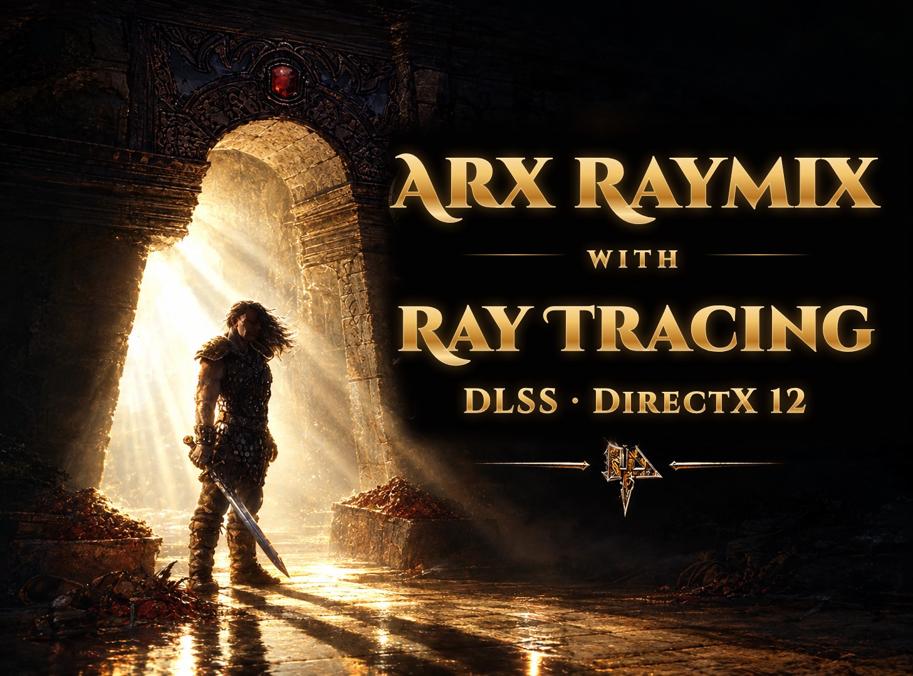
</p>

<p align="center">
  <a href="../README.md">English</a> · <a href="README.pt-BR.md">Português (Brasil)</a>
</p>

# Arx Raymix: guia do jogador

**Arx Raymix** é um remaster de *Arx Fatalis* (Arkane Studios, 2002) para Windows, feito sobre o motor [Arx Libertatis](https://arx-libertatis.org/). Acrescenta um renderizador **Direct3D 12** com **ray tracing DXR** opcional, mais NVIDIA **DLSS** (Super Resolution, Ray Reconstruction), **DLSS Frame Generation** e **Reflex**. O Direct3D 9 continua como alternativa.

É o mesmo jogo. Você precisa ter o seu próprio *Arx Fatalis* (Steam ou GOG). Os dados do jogo não vêm no download e nunca são redistribuídos.

A documentação oficial é a em inglês: [README](../README.md) e [INSTALL.md](INSTALL.md). Para compilar a partir do código, veja [pt-BR/README.md](pt-BR/README.md).

## Imagens

| Ray tracing desligado | Ray tracing ligado |
|---|---|
| 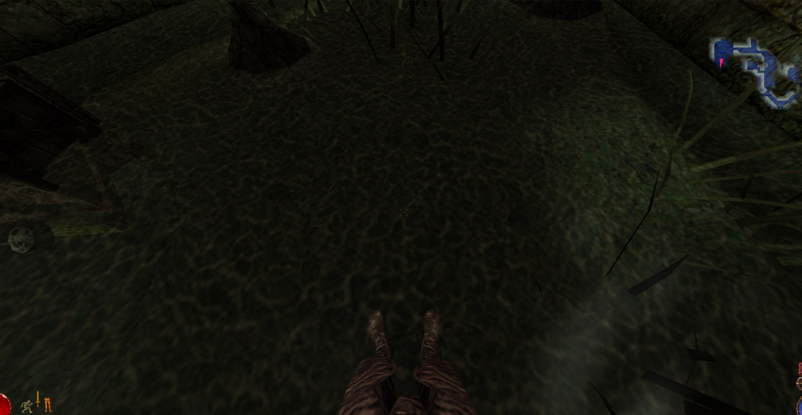 | 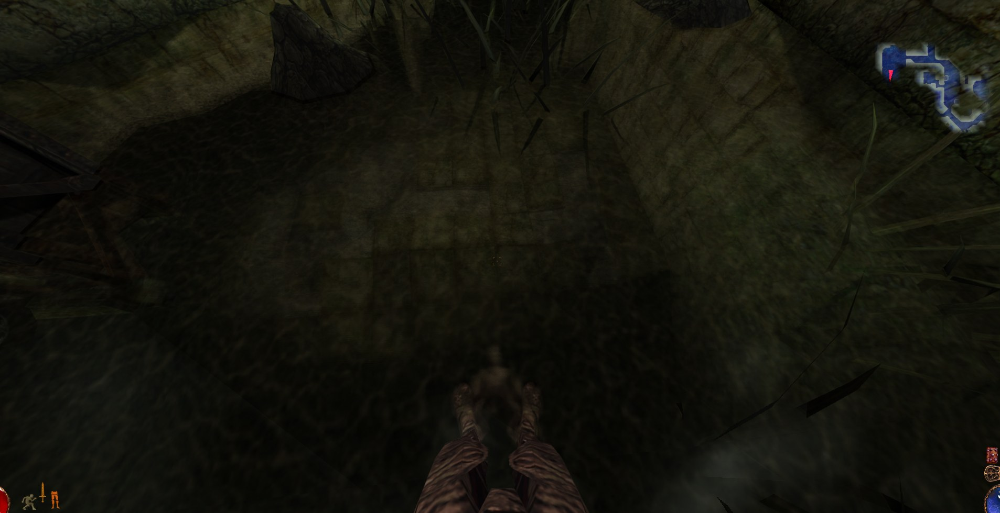 |
| 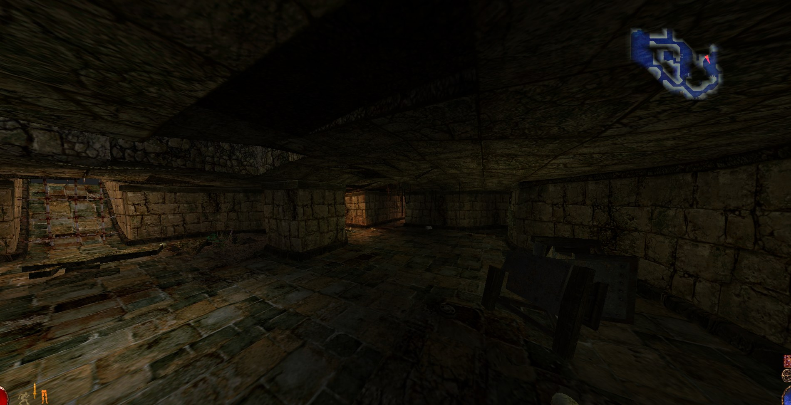 | 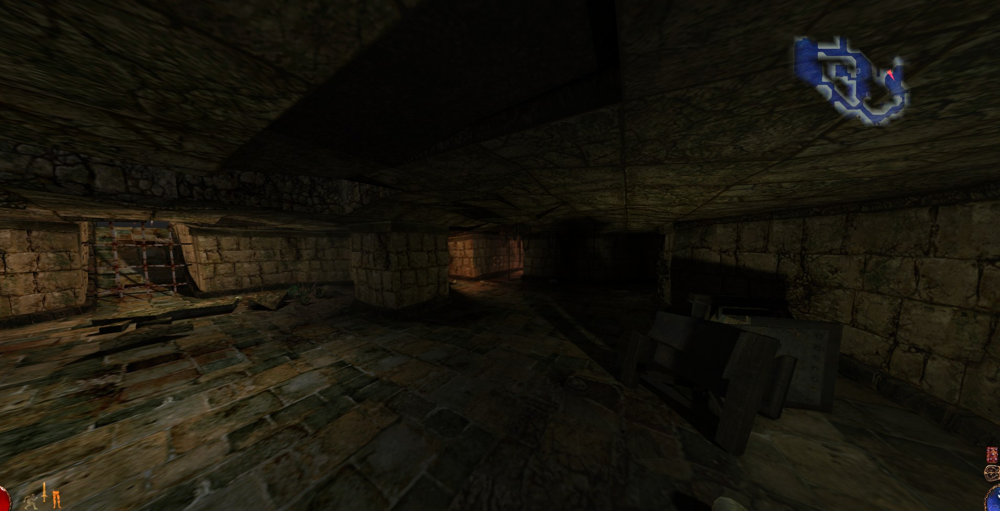 |
| 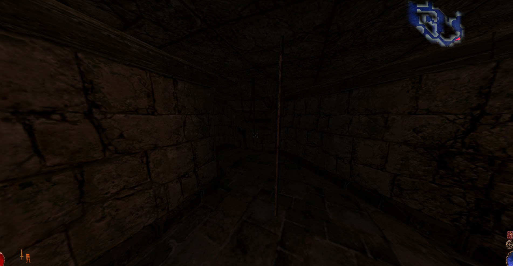 | 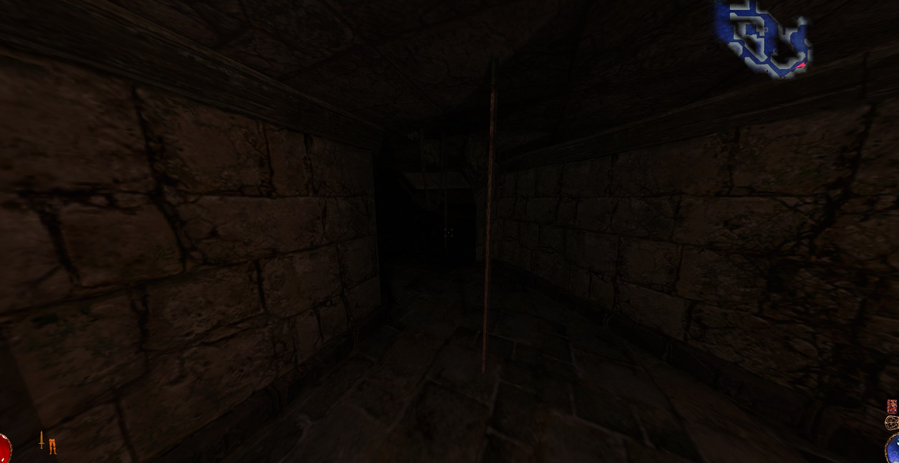 |

<p align="center">
  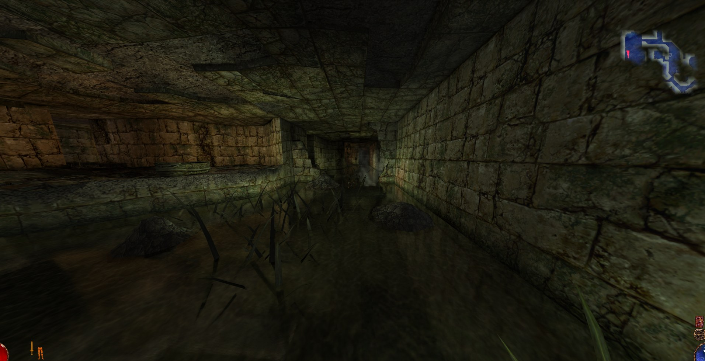
</p>

<p align="center">
  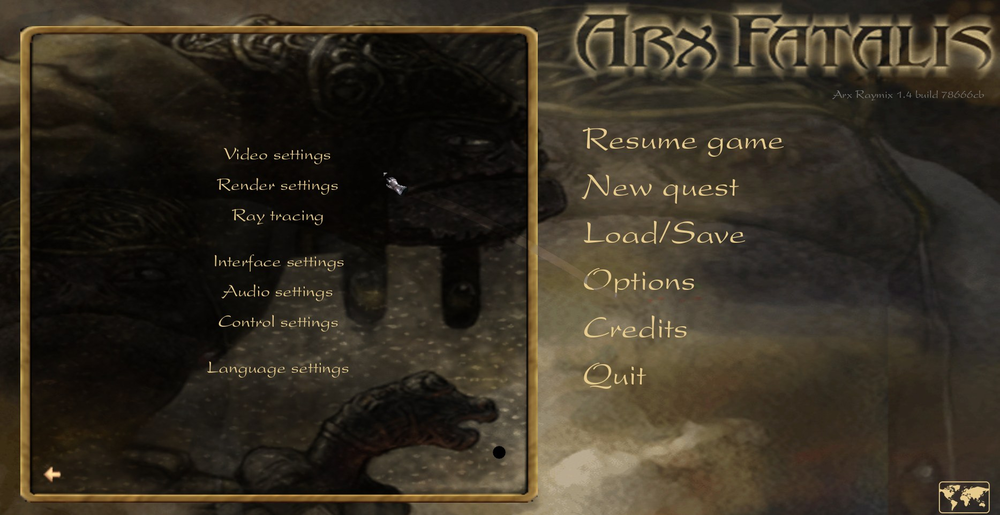 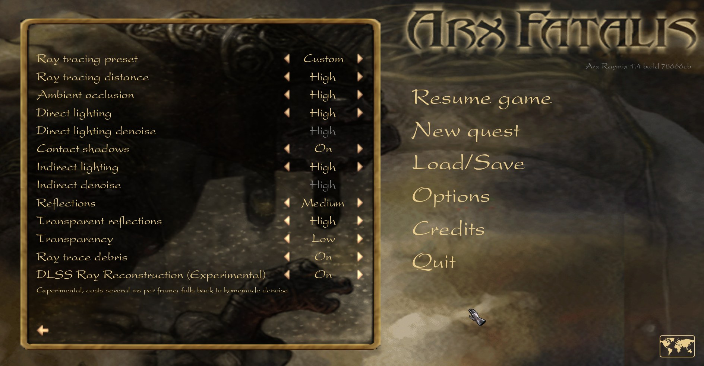 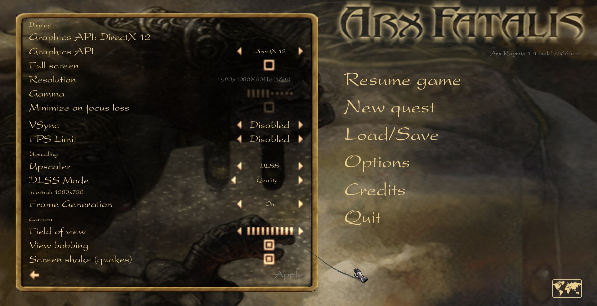
</p>

Cada par é o mesmo lugar com **F7** (ray tracing ligado / desligado). RTX 4050 Laptop, 1920×1080, DLSS Qualidade.

## Requisitos

| | |
|---|---|
| Sistema | Windows 10 ou 11, 64 bits |
| Jogo | Sua cópia de **Arx Fatalis** da Steam ou da GOG |
| GPU básica | Uma GPU com driver Direct3D 12. GPUs antigas usam o Direct3D 9 |
| Ray tracing | Qualquer GPU Direct3D 12. Com suporte a DirectX Raytracing (DXR), roda nos núcleos RT, com cada efeito até Alto; sem DXR, roda por software, com cada efeito limitado a Baixo |
| DLSS Super Resolution / Ray Reconstruction | GPU NVIDIA GeForce RTX |
| DLSS Frame Generation | GPU NVIDIA GeForce RTX série 40 ou mais nova |
| GPU mínima / recomendada | <!-- TODO Gabriel: preencher --> |

Não é preciso mais nada: nem patch, nem outro mod, nem o Arx Libertatis instalado. As versões da Steam e da GOG já trazem os dados de que o motor precisa.

**Sem DXR** (GeForce GTX antigas, AMD Radeon RX 5000 e anteriores, Intel antigas), o ray tracing roda por software: os mesmos efeitos, cada um limitado a Baixo. Ele começa desligado; ligue em Opções → Ray tracing. **Sem GPU NVIDIA RTX**, as opções de DLSS ficam cinza, com o motivo escrito. No Direct3D 9 e no OpenGL não há ray tracing nem DLSS.

## Download

- **Nexus Mods** (canal principal): <https://www.nexusmods.com/arxfatalis/mods/37>
- **GitHub Releases**: <https://github.com/gabriel7silva/ArxRaymix/releases>

## Instalação

1. **Instale o Arx Fatalis** pela Steam ou pela GOG.
   - Steam: clique com o botão direito no jogo → *Gerenciar* → *Explorar arquivos locais* para achar a pasta.
   - GOG Galaxy: botão de configurações do jogo → *Gerenciar instalação* → *Mostrar pasta*.
   - A pasta certa é a que tem o arquivo `data.pak`. Anote o caminho.
   - É recomendado abrir o jogo original uma vez antes.
2. **Instale o Arx Raymix**, de um destes jeitos:
   - **Instalador (recomendado):** execute o `ArxRaymix-vX.Y-setup.exe`. Ele instala só para o seu usuário, sem pedir administrador, em `%LOCALAPPDATA%\Programs\ArxRaymix` (dá para escolher outra pasta). Cria atalhos no Menu Iniciar (e, se quiser, na Área de Trabalho) e aparece em **Configurações → Aplicativos**.
   - **Zip:** extraia numa pasta própria, por exemplo `C:\Jogos\ArxRaymix`. **Não** extraia dentro da pasta do Arx Fatalis. Evite `C:\Arquivos de Programas`.
3. **Execute** *Arx Raymix* pelo Menu Iniciar, ou o `ArxRaymix.exe` (ou `arx.exe`).

**Aviso "O Windows protegeu o computador":** o Arx Raymix **ainda não tem assinatura digital**, então o SmartScreen do Windows avisa na primeira vez que você abre o instalador, o `ArxRaymix.exe` ou o `arx.exe` ("Editor desconhecido"). A assinatura digital está planejada para uma próxima versão. Para continuar, clique em **Mais informações** e depois em **Executar assim mesmo**. Para conferir que o arquivo é o original, compare o SHA-256 com o arquivo `.sha256` da página da release (no PowerShell: `Get-FileHash .\ArxRaymix-v1.5-setup.exe -Algorithm SHA256`). Baixe o Arx Raymix só pelo Nexus Mods ou pela página de releases do GitHub.

### Se o jogo não encontrar os dados

O `arx.exe` procura o Arx Fatalis em todas as bibliotecas da Steam e na instalação da GOG registrada no Windows, então uma instalação normal é encontrada sozinha. Se mesmo assim ele não achar (cópia manual ou pasta incomum), crie um atalho para o `arx.exe`, abra *Propriedades* e acrescente `--data-dir` no campo *Destino*, apontando para a pasta que tem o `data.pak`:

```text
"C:\Jogos\ArxRaymix\arx.exe" --data-dir "C:\Program Files (x86)\Steam\steamapps\common\Arx Fatalis"
```

Use os seus caminhos e abra o jogo por esse atalho.


## Idioma

O padrão é **inglês**. Na primeira execução (quando o `cfg.ini` ainda não tem idioma), aparece a tela **Language / Idioma** com os idiomas de texto disponíveis, inglês primeiro. Escolha **Português (Brasil)** se quiser.

Para trocar depois: **Options → Language settings** (em português: **Opções → Idioma**).

- O português cobre os menus e os textos do jogo. Uma linha ainda sem tradução aparece em inglês.
- **As vozes continuam em inglês.** Os arquivos de voz em português são áudio da Arkane e não podem ser redistribuídos, então não vêm no download.

## Primeira execução

Com uma GPU com DXR, o jogo escolhe um preset de ray tracing pela memória de vídeo: Baixo com menos de 5 GiB, Alto a partir de 9 GiB, Médio no meio. Se a GPU tiver DLSS, liga o DLSS Qualidade. Tudo isso pode ser mudado a qualquer momento.

| Onde | O quê |
|---|---|
| Opções → Ray tracing | Preset, cada efeito, distância do ray tracing, DLSS Ray Reconstruction (experimental). Vale na hora |
| Opções → Vídeo | Upscaling (modo do DLSS), Geração de frames (Frame Generation), API gráfica (DirectX 12 / DirectX 9 / OpenGL, vale no próximo arranque; ray tracing e DLSS só no DirectX 12) |
| Opções → Renderização | Distância de renderização |
| Opções → Interface | **Mostrar desempenho**: desligado / FPS / FPS + tempo de GPU (novo na v1.4) |

| Tecla | Ação |
|---|---|
| F7 | Liga / desliga o ray tracing nesta sessão, sem mudar suas configurações (novo na v1.4) |
| F10 | Captura de tela (`snapshot_<n>.bmp` na pasta do usuário) |
| F11 | Alterna o painel de desempenho / depuração |

## Atualização

A partir da v1.4, o `ArxRaymix.exe` consulta a última versão no GitHub ao abrir. Se houver versão nova, oferece **Atualizar agora**, **Agora não** ou **Pular esta versão**. Se você aceitar, ele baixa o zip, confere o SHA-256, troca só os arquivos do mod e abre o jogo. A versão anterior fica na pasta `backup`, e `ArxRaymix.exe --rollback` volta para ela. Sem internet ou com erro, ele só abre o jogo. Baixou o zip pelo Nexus? `ArxRaymix.exe --install <zip>` instala do mesmo jeito. Ele **nunca** mexe no `cfg.ini`, nos saves nem na pasta do Arx Fatalis.

Quem abre o `arx.exe` direto vê um aviso de **nova versão disponível** no menu principal. Para desligar: **Opções → Interface → Verificar atualizações**.

Para atualizar à mão: baixe o zip novo, feche o jogo e extraia por cima da pasta antiga (ou numa pasta nova). Configurações e saves ficam na pasta do usuário e continuam valendo.

## Desinstalação

Instalou pelo instalador: **Configurações → Aplicativos → Arx Raymix → Desinstalar**, ou *Desinstalar o Arx Raymix* no Menu Iniciar. Instalou pelo zip: apague a pasta do Arx Raymix. O Arx Fatalis não foi alterado.

Configurações e **saves** ficam em `%USERPROFILE%\Saved Games\Arx Libertatis` (ou `Documentos\My Games\Arx Libertatis`, se essa pasta já existir). Apague essa pasta só se quiser perder os saves. O Arx Libertatis usa a mesma pasta.

## Problemas

- **`arx.log`** fica na mesma pasta do usuário e é reescrito a cada abertura. Anexe-o a qualquer relato de bug, com a sua GPU, a versão do driver e as configurações usadas.
- `arx.exe --list-dirs` mostra as pastas que o jogo está usando.
- **Abriu em DirectX 9** ou o ray tracing está cinza: atualize o driver da GPU e confira **Opções → Vídeo**.
- `Arx Raymix - DirectX 9.bat` abre o Direct3D 9 só naquela sessão, sem mudar o `cfg.ini`.

Mais detalhes, em inglês: [INSTALL.md](INSTALL.md#troubleshooting).

## Direitos autorais

- O **código do motor** é GPLv3 ([LICENSE](../LICENSE)): Copyright (C) 2011-2023 Arx Libertatis Team and Contributors, com as mudanças do Arx Raymix por Gabriel Silva, baseado no código-fonte GPLv3 de Arx Fatalis, Copyright (C) 1999-2010 Arkane Studios SA, uma empresa ZeniMax Media.
- **Arx Fatalis** e os dados do jogo são © Arkane Studios / ZeniMax Media / Bethesda Softworks. Não vêm no download.
- As DLLs de **NVIDIA DLSS, Streamline e Reflex** são © NVIDIA Corporation e seguem a licença da própria NVIDIA, não a GPLv3.
- As bibliotecas de terceiros mantêm as suas licenças: veja [THIRD-PARTY-NOTICES.md](../THIRD-PARTY-NOTICES.md). O zip traz todos os textos de licença na pasta `licenses\`.

O Arx Raymix não tem vínculo com a Arkane Studios, a ZeniMax Media, a Bethesda Softworks nem a NVIDIA, e não é endossado por elas.
